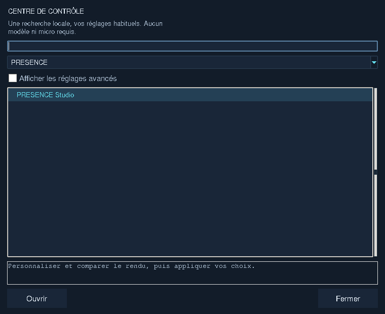
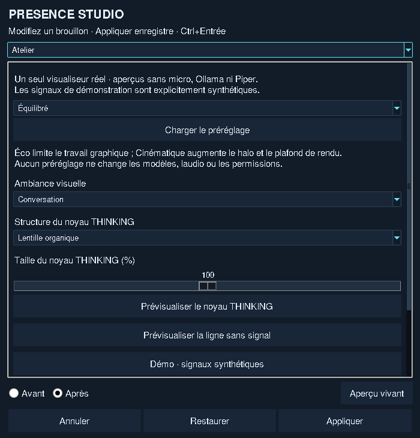
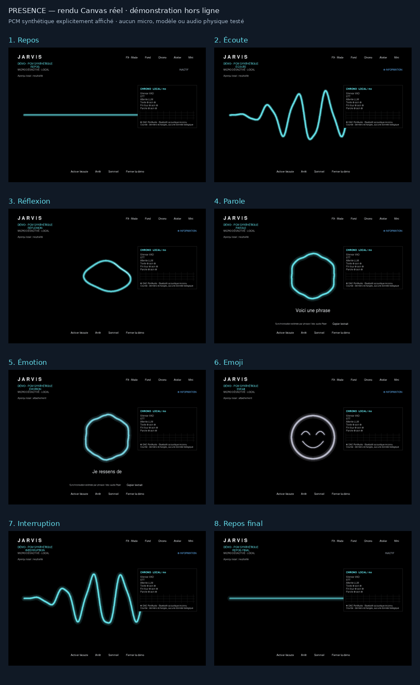

# Centre de contrôle et PRESENCE Studio 2.0

Dans COMMAND OS, **Menu → Centre de contrôle**, ou **Ctrl+,**. Cinq familles
regroupent les éditeurs existants ; les valeurs restent dans leurs paramètres
SQLite habituels. La recherche est locale, insensible aux accents et porte sur
toutes les familles. Une recherche révèle aussi les entrées avancées.
Ctrl+F revient à la recherche, flèche bas puis Entrée ouvre le résultat,
Tab/Maj+Tab parcourt les commandes, Escape ferme le panneau.



## Personnaliser PRESENCE

Ouvrir **PRESENCE → PRESENCE Studio** dans le Centre, ou **Atelier** dans
PRESENCE. Le sélecteur en haut donne accès à cinq sections, chacune défilante :
Atelier, Visualiseur, Spectre et aperçu, Sous-titres, Expressions.

1. Modifier le brouillon, ou charger un préréglage Éco/Équilibré/Cinématique.
2. Choisir **Aperçu vivant**, THINKING, ligne, phrase, microexpression ou emoji.
   L'aperçu utilise le vrai Canvas de PRESENCE, sans lancer Ollama ni le micro.
3. **Avant / Après** alterne les valeurs enregistrées et le brouillon sur ce
   même visualiseur. Les deux fenêtres peuvent être déplacées/redimensionnées.
4. **Appliquer** enregistre localement ; **Annuler** abandonne les changements
   non appliqués. **Restaurer** prépare les valeurs d'origine dans le brouillon :
   il faut encore Appliquer pour les enregistrer. Ctrl+Entrée applique.



Épaisseur, halo et diffusion sont graphiques ; ils ne changent ni gain micro,
ni seuil VAD, ni voix. La diffusion étale les contours lumineux Canvas ; ce
n'est pas un flou volumétrique GPU. La structure et la vitesse du noyau changent
réellement sa géométrie/animation. La vitesse des transitions règle l'inertie
visuelle hors capture : l'attaque/retour du signal microphone reste prioritaire.
Les préréglages conservent les choix de réduction de mouvement et de morphing.
Les palettes émotionnelles existantes sont conservées ; ce panneau n'est pas
un éditeur libre de chaque catégorie chromatique.

Les vrais événements vocaux annulent l'aperçu et restaurent les réglages
enregistrés ; le brouillon reste disponible. F9/F10 et les autres changements
externes enregistrés sont conservés lors de la fermeture du Studio. Un échec
d'écriture est affiché et laisse le brouillon intact.

## Démonstration hors ligne

Dans Atelier, **Démo · signaux synthétiques** joue :
Repos → Écoute → Réflexion → Parole → Émotion → Emoji → Interruption → Repos.
Le signal est déclaré synthétique à l'écran ; aucun micro, Piper ou Ollama
n'est démarré. Le même Canvas, le contrôleur de morphing et les événements de
fin de segment sont utilisés. Huit familles expressives préexistantes restent
prises en charge ; aucune bibliothèque supplémentaire de100emojis n'est annoncée.

Depuis les sources sous Windows, avec l'environnement Python de JARVIS :

```powershell
py run_presence_demo.py --auto-close
py run_presence_demo.py --reduced-motion --auto-close
```

Le script utilise un profil temporaire isolé : il ne lit ni ne remplace votre
SQLite personnelle. Pour capturer les huit états, Pillow doit être déjà installé
dans cet environnement ; il reste facultatif et aucun téléchargement n'est lancé :

```powershell
py run_presence_demo.py --auto-close --capture-dir .\captures-presence
```

Choisir un dossier vide ou nouveau : les images existantes ne sont pas écrasées.
Les captures reflètent le bureau réel, donc garder la fenêtre visible. La vidéo
ci-dessous vient de véritables captures Canvas Linux, avec des signaux
synthétiques : export fixe25images/s,202images. Ce débit d'encodage n'est pas
une mesure de performance ni un enregistrement de votre matériel.

[Lire la démonstration MP4](assets/presence-studio-demo.mp4)



## Mesures et limites

Observation Linux du seul processus d'aperçu Canvas, sans IA ni audio actifs :
5,02s au repos, CPU moyen0,47% d'un cœur, RSS moyen36,38MiB, pic de vie55,14MiB.
Aucun callback Canvas actif après stabilisation, démonstration arrêtée.
[Données et périmètre exacts](benchmarks/presence-studio-idle-linux.json).
Ce court relevé ne compare pas avant/après et ne mesure ni Windows, RTX, VRAM,
watts ou latences vocales. Voir aussi les
[mesures du prototype GPU séparé](PRESENCE-GPU-BENCHMARKS.md).

Canvas reste actif en production. `PresenceSettings` constitue le schéma validé
commun ; aucun second stockage n'est créé. Le prototype OpenGL réutilise déjà
`PresenceModel`, mais le raccordement des réglages aux shaders et une intégration
Tk/voix restent à faire après mesures RTX3070. ModernGL n'est pas obligatoire.

Le Centre et les formulaires modèle/Voix/Studio ont été testés à petites tailles,
en paysage/portrait et aux échelles100/250% sous Linux/Tk8.6 etTk9. L'éditeur
de mémoire existant garde sa largeur minimale820px. Tableaux Markdown textuels,
mathématiques simples et acceptation esthétique Windows restent des limites
connues ; **LOT2 non officiellement validé**. LOTS4/5/7 hors mission.

## Recette à votre retour sur Windows11

- Ouvrir le Centre, chercher « épaisseur », « silence », « police », « mémoire » ;
  vérifier clavier, paysage/portrait et DPI entre moniteurs.
- Modifier le Studio, comparer Avant/Après ; Annuler puis rouvrir. Appliquer une
  autre valeur, redémarrer JARVIS et vérifier sa conservation.
- Jouer la démonstration, puis réduire les mouvements et recommencer. Vérifier
  halo, lisibilité et arrêt immédiat à la fermeture ou au retour COMMAND OS.
- Reprendre le micro réel : silence/parole/silence, RMS, onde, VAD→Whisper,
  réponse Qwen/Piper ; les aperçus ne doivent pas bloquer une interruption.
- Faire prononcer « Heureux de te revoir 😊 », « Je t'aime ❤️ », « C'est drôle 😂 » ;
  vérifier les symboles puis Mini/F10 et le retour normal.

**Validation matérielle en attente.** Les tests automatisés et la compilation
Windows CI ne prouvent ni la capture de votre micro, ni la qualité audible,
ni l'absence d'impact GPU sur les moteurs locaux de votre PC.
