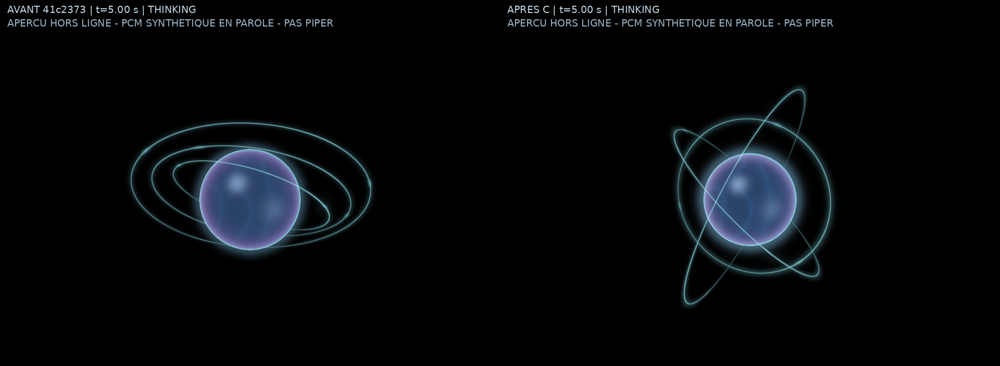
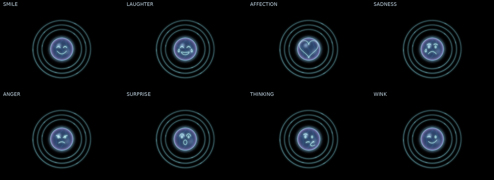

# PRESENCE GPU 3.0 — C puis D

27 octobre 2026. L'utilisateur a validé la direction artistique A+B (`41c2373`) :
noyau iridescent, trois anneaux et fond noir conservés. Sa demande est archivée
dans [la spécification C+D](PRESENCE-GPU-3.0-CD-SPEC.md).
Le prototype reste indépendant de `Jarvis.exe` ; Canvas est le moteur stable.

## C — Animation, états et audio

Trois plans orbitaux tournent autour du même centre par rotations de Rodrigues,
avec axes 3D et vitesses signées indépendants. Les angles sont intégrés, jamais
réinitialisés lors d'un changement d'état. L'inertie est exponentielle (0,45 s) ;
le noyau rejoint progressivement 92 % de sa taille en THINKING (0,30 s), puis
sa taille normale en parole. Les plans et l'occlusion utilisent le même rayon.

Le noyau reste visible en écoute et en parole, même sans PCM. Au repos, les
orbites et le rendu se suspendent après stabilisation ; l'option de ligne
classique reste disponible. Les angles explicites sont figés en réduction du
mouvement, sans retour à zéro. Le temps écoulé masqué ne provoque pas de saut.
Une sphère allumée ou des orbites d'état ne constituent pas une activité audio.

Les profils GPU Éco / Équilibré / Cinématique dessinent respectivement
24 / 96 / 192 particules fines ; plafonds internes 960×540 / 1280×720 / 1920×1080.
Les particules ont une profondeur et des enveloppes continues. Le halo renforcé
reste issu du noyau et des orbites, sans fond coloré ni nouvelle texture.

### Bandes audio

`audio_spectrum.py` fournit une vraie FFT avec fenêtre Hann et retrait du continu :
graves 80–350 Hz, médiums 350–2 500 Hz, aigus 2 500–8 000 Hz. Fenêtre PCM typique
de 32 ms, maximum 4 096 échantillons ; à très haute fréquence ce plafond raccourcit
la fenêtre et réduit la précision. C'est un spectre visuel, pas un analyseur studio.

Le worker calcule au plus 25 fois/s, hors boucle graphique et callback audio,
avec un seul bloc en attente. Résultats expirants (200 ms), génération et révision
invalident les travaux anciens ; fermeture avec attente bornée et erreurs visibles.
Le rendu lisse les bandes (attaque 55 ms, relâchement 240 ms). Les graves modulent
l'aura, les médiums la matière et les aigus les reflets/orbites. Sans PCM valide,
les valeurs reviennent au calme ; aucune énergie n'est inventée.

**Le flux Piper en direct n'est pas branché au prototype autonome.** Le module
accepte son PCM pour une future intégration ; aujourd'hui `--wav` lit un vrai
enregistrement PCM16, notamment un export Piper fourni par l'utilisateur. Il
ne le joue pas et ne capture aucun micro. Les preuves utilisent des tons PCM
synthétiques explicitement indiqués, pas une voix Piper simulée.

### Commandes

```powershell
.\JarvisPresenceGPU.exe --state thinking --quality balanced --require-hardware
.\JarvisPresenceGPU.exe --state speaking --wav "C:\Audio\piper.wav" --require-hardware
```

| Commande | Action |
| --- | --- |
| I / L / T / S | Repos / écoute / réflexion / parole |
| X | Interruption, annulation de l'expression et suspension de l'ancien WAV |
| L ou S après X | Reprise explicite de l'entrée enregistrée |
| Q | Éco → Équilibré → Cinématique |
| V / `--idle-line` | Sphère ou ligne classique au repos |
| R / `--reduced-motion` | Réduction du mouvement |
| C | Couleur d'aperçu |
| 1 / 2 / 3 | Sourire / affection / rire |
| Échap | Fermer et libérer les ressources |

I/T suspendent aussi le WAV. Le titre distingue source absente, enregistrement,
WAV suspendu et erreur spectrale ; aucune mention de microphone/Piper actif.



[Vidéo C, 10 secondes](assets/presence-gpu30-C-comparison.mp4) : 250 frames
OpenGL, THINKING prolongé puis SPEAKING, chaque viewport 960×640, légendes hors
rendu. 25 images/s d'export ne mesurent pas les FPS. Scène **et** renderer de
`41c2373` pour la référence ; pipeline courant pour C. [Manifest et hashes](assets/presence-gpu30-C-evidence.json).
Autres captures : [repos](assets/presence-gpu30-C-idle.png),
[écoute](assets/presence-gpu30-C-listening.png),
[graves](assets/presence-gpu30-C-speaking-bass.png),
[médiums](assets/presence-gpu30-C-speaking-mid.png),
[aigus](assets/presence-gpu30-C-speaking-treble.png).

Validation C : 83 tests ciblés réussis, dont 24 vrais tests EGL et 12 tests
FFT/worker. Axes, centrage, occlusion, contraction, bandes, générations,
interruption WAV, réduction du mouvement, huit symboles existants et ressources.
Le morphing encore plat de la référence est traité séparément par D.

### Mesures C

[Rapport brut](benchmarks/presence-gpu30-C-linux.json), Mesa llvmpipe LLVM19.1.7,
processus frais et cinq secondes par cas, sans capture ou tests concurrents.
Rendu terminé par `ctx.finish()` ; cadences de mesure 15/30/45 FPS pour comparer
les mêmes profils (la fenêtre interactive autorise 60 FPS en Cinématique).

| Profil THINKING | FPS A+B → C | CPU A+B → C | RSS moyen A+B → C | Rendu C P50/P95 |
| --- | ---: | ---: | ---: | ---: |
| Équilibré | 29,89 → 29,71 | 221,39 → 183,08 % | 105,11 → 98,84 MiB | 13,92/23,19 ms |
| Cinématique | 43,85 → 44,63 | 318,32 → 263,06 % | 98,89 → 102,27 MiB | 13,16/15,85 ms |

Éco C : 14,97 FPS, 66,32 % CPU, 97,11 MiB RSS moyen. Repos/réduit : une frame
puis attente sur cinq secondes, avant/après. 100 % CPU = un cœur. Équilibré et
Cinématique à 960×640 : toujours 7 380 864 octets graphiques demandés (7,04 MiB),
hors driver et présentation. Ces courts relevés ne prouvent aucun gain statistique,
mémoire ou RTX ; VRAM physique, watts, temps GPU précis et impact IA non mesurés.

## D — Gravure surfacique

Les **huit familles existantes** sont projetées sur l'hémisphère visible :
sourire, rire, affection, tristesse, colère, surprise, réflexion et clin d'œil.
Les visages utilisent les détails du catalogue ; leur ancien cercle n'est pas
redessiné, puisque la sphère fournit la silhouette. Le cœur utilise son contour.
Les coordonnées locales deviennent des positions 3D sur la sphère avant la
projection perspective, avec modulation selon la normale et découpe à la surface.
Le matériau, le halo et le volume ne disparaissent plus.

Le même VBO et le même passage des courbes sont réutilisés. Aucun bitmap,
nouveau visualiseur ou modèle. Le `MorphController` existant conserve les durées
et l'annulation ; la gravure apparaît puis se dissipe progressivement. Les
orbites ralentissent et rejoignent des couronnes concentriques par interpolation
de leur orientation, puis reprennent leurs angles continus. Les trois signes
quaternion sont choisis à l'entrée, conservés jusqu'au retour, pour éviter un
basculement de chemin à 180°. Les bases sont calculées dans le vertex shader,
et transmises aux fragments ; aucun calcul d'orientation par pixel nécessaire.

Les expressions sont possibles en THINKING, repos et parole. Le PCM en état
parole ne les annule plus ; une vraie écoute utilisateur, X ou un changement
d'état les annulent. Les événements d'une ancienne génération sont ignorés.
Les exclusions de code, citations et
exemples techniques sont conservées. En réduction du mouvement, le symbole
reste statique et une dernière frame le retire à l'échéance ; pas de timer ajouté.
La suspension du WAV par X empêche la réinjection d'une ancienne réponse.



[Sourire](assets/presence-gpu30-D-smile.png) ·
[Rire](assets/presence-gpu30-D-laughter.png) ·
[Affection](assets/presence-gpu30-D-affection.png) ·
[Avant/après C→D](assets/presence-gpu30-D-comparison.png) ·
[Vidéo D](assets/presence-gpu30-D-comparison.mp4) ·
[Interruption](assets/presence-gpu30-D-interruption.png) ·
[Manifest](assets/presence-gpu30-D-evidence.json).

L'export compare les vrais adaptateurs et renderers C/D. Les expressions sont
déclenchées par horloge de test et les bandes viennent de PCM synthétique signalé.
Cela valide le parcours de l'adaptateur et du renderer, pas une synchronisation
mot à mot avec Piper. La liaison au PCM/aux événements de la voix de production
reste réservée à une future intégration GPU, après recette matérielle.

Validation D ciblée : 91 tests réussis, dont 29 vrais tests EGL. Projection sur
l'hémisphère, maintien du matériau, huit tracés distincts, transparence progressive,
occlusion, phases longues, ±π/2π, interpolation et interruption sont contrôlés.

Suite complète Linux/Tk9/EGL requis : **660 tests exécutés, 651 réussis,
9 ignorés**, 77,068 s. Les ignorés concernent les mêmes six dépendances natives
absentes et trois essais réels opt-in. Sonde EGL source : shaders compilés,
vraie frame et libération complète. Ces résultats ne valident pas le matériel.

### Mesures D

[Rapport D](benchmarks/presence-gpu30-D-linux.json), mêmes conditions isolées que
C, cinq secondes par cas, sans export ou test concurrent. Aucun gain statistique
ou matériel n'est établi par ces fenêtres courtes.

| Cas D | FPS | CPU moyen | RSS moyen | Rendu P50/P95 |
| --- | ---: | ---: | ---: | ---: |
| THINKING Éco | 14,97 | 65,30 % | 97,51 MiB | 10,89/16,01 ms |
| THINKING Équilibré | 29,86 | 166,49 % | 101,66 MiB | 12,76/18,00 ms |
| THINKING Cinématique | 44,61 | 256,61 % | 99,44 MiB | 13,22/16,35 ms |
| Expression, Équilibré | 29,79 | 171,74 % | 99,48 MiB | 13,22/18,00 ms |

Le cas `--case expression` déclenche un sourire hors ligne toutes les 1,5 s,
avec les durées réelles du contrôleur, sans PCM ni Piper. Repos/réduit : une frame
puis attente de cinq secondes. Toujours 7,04 MiB demandés à 960×640 en Équilibré,
sans nouvelle texture/VBO/passe. CPU 100 % = un cœur, Mesa logiciel ; VRAM physique,
watts, timestamps GPU, TTFT/tokens Ollama et latence voix restent non mesurés.

C : [CI Windows application](https://github.com/ABBYWILLY/JARVIS-0.0.1/actions/runs/40578074554)
et [prototype](https://github.com/ABBYWILLY/JARVIS-0.0.1/actions/runs/40578074556)
vertes. Suivre le SHA D livré dans les mêmes workflows. L'artefact prototype
reste séparé de `Jarvis.exe` ; une sonde Windows sans pilote peut signaler
explicitement son indisponibilité, ce qui ne prouve pas un rendu RTX.

## Périmètre de validation

Les mesures sont exécutées séparément des captures. Le helper
`scripts/compare_presence_gpu.py --historical-scene` utilise aussi l'adaptateur
d'états de la révision choisie ; les modules Canvas/morphing communs restent
inchangés. Sans ce drapeau, tout champ incompatible avec une ancienne API est
explicitement listé dans le rapport : aucune omission n'est silencieuse.

**Validation matérielle en attente** : Windows 11, RTX 3070 avec Ollama et vraie
voix. Mesa est un renderer logiciel et ne prédit pas les performances RTX.
Pas de modèle ou dépendance obligatoire ajouté. Aucun sous-lot E/F fonctionnel,
aucune intégration GPU dans `Jarvis.exe`, aucun LOT 4/5/7 et aucune modification
de `main`. L'avis artistique C/D reste à recueillir sur les preuves et sur PC.
