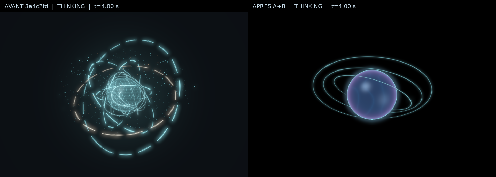

# PRESENCE GPU 3.0 — revue artistique A + B

27 octobre 2026. Prototype autonome ; Canvas reste le moteur de `Jarvis.exe`.
Référence avant travaux : `3a4c2fd`, branche `feat/jalon-2-voice-presence`.

## Point d'arrêt utilisateur

Cette livraison concerne exclusivement **A — Direction artistique** et
**B — Matière et lumière**. Les captures, export vidéo, tests, mesures et CI
servent à leur validation intermédiaire ; ils n'ouvrent pas les sous-lots
C (animations/états), D (gravure morphologique), E (nouveaux scénarios) ou
F (campagne d'optimisation). Attendre l'avis artistique de l'utilisateur avant
de les commencer. Aucun accord esthétique ou essai matériel n'est présumé.

## A — Composition

- Fond RGB `(0, 0, 0)` ; seule la lumière des objets s'étend sur le noir.
- Sphère centrale agrandie, trois orbites apparentées et espacées ; suppression
  de la spirale et de la cage de filaments permanentes en plein THINKING.
- 24 particules orbitales en Équilibré, 36 en Cinématique, contre 768/1 536.
  Les accents filaires nécessitent un RMS fourni non nul ; aucun PCM inventé.
- Caméra et occlusion analytique partagées, mêmes entrées et états existants.

La vérification du noir a aussi révélé une fuite réelle : près d'une intersection
rasante rayon/plan, la dérivée utilisée pour l'anticrénelage pouvait devenir
immense et éclairer des pixels loin des anneaux. Sa largeur est bornée dans le
shader ; le fond n'est pas artificiellement masqué à la composition finale.

L'API, les allocations, le contrôle d'interruption, les huit familles de symboles
existantes et le repos en ligne sont conservés. Le nouveau repos sphérique,
les animations d'entrée THINKING et les expressions gravées restent différés.

## B — Matière et lumière

Fresnel de Schlick selon l'angle entre normale et direction de vue, palette
cyan/bleu/violet avec magenta discret et teinte `u_color` conservée. Le noyau
utilise une épaisseur analytique et une transmission Beer–Lambert simulée,
un champ interne de basse fréquence, deux reflets spéculaires et un bord lumineux.
Les stries et le quadrillage de surface sont retirés.

Il s'agit d'une **translucidité visuelle simulée**, sans réfraction physique
d'environnement ni transmission des anneaux arrière à travers la sphère.
Leur occlusion précédente reste active. Le bloom extrait les hautes lumières
HDR au-dessus de 0,8, avec rampe progressive jusqu'à 1,4, puis réutilise le flou
au quart de résolution. Pas de nouvelle texture, passe ou allocation.

## Preuves issues du renderer



[Image avant native](assets/presence-gpu30-before.png) ·
[Image après native](assets/presence-gpu30-after.png) ·
[Composition A seule](assets/presence-gpu30-A-thinking.png) ·
**[Vidéo comparative de cinq secondes](assets/presence-gpu30-comparison.mp4)**.

Chaque version est rendue réellement en OpenGL/EGL à **960 × 640**, profil
Équilibré, état THINKING, couleur identique, instant t = 4 s. La planche et la
vidéo juxtaposent les viewports sans redimensionnement ; les légendes occupent
48 px supplémentaires hors rendu. La vidéo contient 125 frames réelles aux
horloges 4 à 8,96 s, encodées à 25 images/s, sans audio. Ce débit d'export ne
mesure pas les performances. ffprobe et le décodage des frames 0/62/124 vérifiés.

[Manifest de preuves et hashes](assets/presence-gpu30-evidence.json) : sources,
assets, contexte et limites identifiés. Aucun dessin généré indépendamment,
retouche du noyau ou asset tiers. Cette démonstration reprend uniquement le
THINKING existant ; elle ne livre pas les futures animations d'états ou gravures.

## Mesures disponibles

[Rapport brut avant/après](benchmarks/presence-gpu30-linux.json). Mesa llvmpipe
LLVM 19.1.7 **logiciel**, processus frais par cas, cinq secondes, shaders chauffés,
captures exclues, attente `ctx.finish()` incluse. Aucun export ou test concurrent.
Cadences cibles identiques : 30 images/s Équilibré, 45 Cinématique.

| Cas | FPS avant → après | CPU avant → après | RSS moyen avant → après | Rendu P50/P95 avant → après |
| --- | ---: | ---: | ---: | ---: |
| THINKING Équilibré | 29,89 → 29,88 | 330,50 → 214,96 % | 101,60 → 101,20 MiB | 24,17/31,58 → 16,49/23,06 ms |
| THINKING Cinématique | 34,55 → 44,01 | 391,29 → 311,81 % | 101,67 → 101,17 MiB | 25,87/40,97 → 15,85/20,05 ms |

100 % CPU = un cœur, threads du driver logiciel inclus. Repos et mouvement
réduit : une frame puis attente pendant cinq secondes dans les deux versions.
Ressources demandées identiques : **7 380 864 octets (7,04 MiB)**, hors driver,
programmes et framebuffer de présentation. Cela ne mesure pas la VRAM physique.
Ces fenêtres courtes ne démontrent pas un gain statistique, mémoire ou RTX.
VRAM physique, temps GPU par timestamp, watts et impact Ollama/voix non mesurés.

Reproduction dans l'environnement facultatif GPU, dossier de sortie inexistant :

```powershell
py scripts/compare_presence_gpu.py --revision 3a4c2fd --case balanced --backend default --seconds 5 --output revue-avant
py scripts/compare_presence_gpu.py --revision current --case balanced --backend default --seconds 5 --output revue-apres
```

Cas complémentaires : `idle`, `cinematic`, `reduced`. Backend `egl` sous Linux ;
`default` pour le contexte natif Windows. La référence concerne seulement les
sources renderer/shaders ; le pipeline d'états/morphing reste identique.

## Validation et limites

**A : 56 tests ciblés réussis**, dont 17 tests du renderer sur un vrai contexte
EGL ; noir RGB exact avec/sans bloom, réduction du mouvement, huit symboles,
PCM, interruptions, fichiers et libération des ressources.

**Suite complète Linux/Tk9/EGL : 627 tests exécutés, 618 réussis, 9 ignorés,
78,382 s.** Les neuf ignorés restent les dépendances natives et essais réels
opt-in absents du cloud. Sonde source EGL : shaders compilés, vraie frame,
fermeture complète.

**B : 58 tests ciblés réussis**, dont 19 vrais tests EGL du renderer. Ajouts :
fond noir en paysage/portrait, exclusion des tons sombres du bloom, maintien de
l'énergie HDR et dépendance angulaire du Fresnel. Les contrôles PCM, huit symboles,
interruptions, réduction du mouvement et libération des ressources sont conservés.

Commande ciblée Linux/EGL (GPU requis pour ne pas ignorer les shaders) :

```bash
JARVIS_REQUIRE_GPU=1 python -m unittest -v tests.test_gpu_renderer tests.test_gpu_benchmark tests.test_presence_gpu tests.test_gpu_comparison
```

Ces tests utilisent EGL : les exécuter dans la recette Linux/Mesa du workflow,
pas en supposant EGL disponible sur Windows. Les sondes source/EXE Windows
utilisent le contexte natif et le script de compilation existant.

A publié : `add5cf4`, [CI application verte](https://github.com/ABBYWILLY/JARVIS-0.0.1/actions/runs/40552255549)
et [CI prototype verte](https://github.com/ABBYWILLY/JARVIS-0.0.1/actions/runs/40552255586).
Le résultat B du SHA livré est à consulter dans les mêmes workflows Actions.
Une CI Windows verte atteste la compilation et les sondes prévues ; un runner
sans pilote peut signaler explicitement OpenGL indisponible. Ce n'est pas un
essai du rendu sur RTX.

## Recette utilisateur à la reprise

Télécharger l'artefact **Jarvis-Presence-GPU-Windows-x64-<SHA>** du dernier run
vert du [workflow prototype](https://github.com/ABBYWILLY/JARVIS-0.0.1/actions/workflows/presence-gpu.yml),
extraire dans un nouveau dossier, puis ouvrir PowerShell dans ce dossier :

```powershell
.\JarvisPresenceGPU.exe --state thinking --quality balanced --require-hardware
```

Observer le noir, le volume, les reflets, les orbites et le halo ; comparer
Cinématique avec `--quality cinematic`, mouvement réduit avec `--reduced-motion`,
sans bloom avec `--no-bloom`. Les raccourcis et la compilation locale restent
dans [le guide GPU](PRESENCE-GPU.md). Ne pas installer ce prototype à la place
de `Jarvis.exe`. Un essai avec Ollama et la vraie voix est encore nécessaire.

**Validation matérielle en attente. Validation esthétique utilisateur en attente.**
OpenGL/EGL sous Mesa logiciel ne valide ni la RTX 3070, ni la coexistence avec
Ollama/Whisper/Piper, ni l'esthétique Windows. Aucun modèle, asset tiers, moteur
lourd ou paquet obligatoire ajouté. **Mission arrêtée après A + B : attendre
l'avis utilisateur avant C, D, E ou F.**
