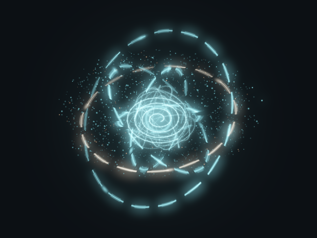

# PRESENCE GPU — mesures disponibles, 23 octobre 2026

**Aucune RTX physique accessible.** Ces mesures sont celles du cloud Linux,
OpenGL4.5 Mesa25/llvmpipe LLVM19 : les shaders s'exécutent réellement dans un
driver **logiciel CPU**. Elles ne prédisent pas les résultats Windows/RTX3070.
Rapport brut : [presence-gpu-linux.json](benchmarks/presence-gpu-linux.json),
versions, périmètres, compteurs manquants et SHA256 des quatre modules inclus.

Un processus et un contexte neufs par cas ; fenêtre de rendu960×640, même cache
disque de shaders Mesa. Pas de micro, modèle ou réseau Ollama. Lecture des
chronométrages avec attente de fin du driver, cadence cible30/60FPS ; adaptation
désactivée pour comparer des profils fixes. Temps de démarrage Python mesuré,
distinct de l'extraction/démarrage du futur EXE Windows.

| Aperçu | Durée | Frames / FPS réel | Médiane / p95 frame | CPU moyen | RAM RSS moyenne / pic |
| --- | ---: | ---: | ---: | ---: | ---: |
| Repos équilibré |5s|1 /0,20|33,43 /33,43ms|1,05%|94,03 /94,83MiB|
| THINKING équilibré |10s|298 /29,70|33,43 /33,59ms|318,37%|94,94 /95,43MiB|
| THINKING cinématique |10s|363 /36,28|24,88 /38,93ms|398,43%|95,11 /95,66MiB|
| THINKING mouvement réduit |5s|1 /0,20|47,27 /47,27ms|3,02%|94,65 /95,52MiB|

Les valeurs exactes font foi dans le JSON. 100%CPU représente un cœur, les
threads Mesa sont inclus. Le repos et le mouvement réduit dessinent **une frame**,
puis attendent ;0,20FPS n'est pas une baisse de fluidité. Les médianes/p95 ne
concernent que les frames rendues, avec attente de cadence ; FPS et durée incluent
les périodes inactives. Pics CPU échantillonnés, pics RSS fournis par le système.

Textures/buffers possédés par GpuRenderer :7 380 864octets demandés à cette taille,
environ7,04MiB. Cette estimation exclut driver, framebuffer de présentation et
autres coûts du contexte. **VRAM physique et utilisation graphique non mesurées**,
`nvidia-smi` absent. Latence/débit Ollama et latences Piper/Whisper/VAD : non mesurés.
Aucune mesure de consommation électrique. Ne pas déduire un gain matériel.

Vérifications supplémentaires : création d'une vraie fenêtre GLFW/GLX sous X11,
sonde EGL, shaders et huit géométries expressives, redimensionnements avec
libération des anciennes textures, shutdown répété et erreurs de fermeture.
Les samplers et historiques restent bornés. Pas de preuve de stabilité en session
prolongée sur RTX, ni de test matériel Windows/DPI entre moniteurs.

La séquence exportée de démonstration utilise210frames du moteur avec horloge
déterministe, encodées à30i/s, sans audio. **Ce n'est pas une mesure de FPS temps
réel.** Les mesures ci-dessus ont été faites séparément, sans cet export.

## Décision

Prototype fonctionnel et testable, **intégration de production différée**.
Le coût CPU du rendu logiciel est trop élevé pour l'IA et justifie son refus par
défaut dans la fenêtre. La décision matérielle exige la recette RTX3070 du
[guide](PRESENCE-GPU.md) : vrai contexte accéléré, ressources, coexistence IA/voix,
interruptions, tailles/DPI et session prolongée. Canvas reste le moteur JARVIS.
Un EXE Windows compilé et une sonde sur runner ne prouvent pas cette acceptation.
