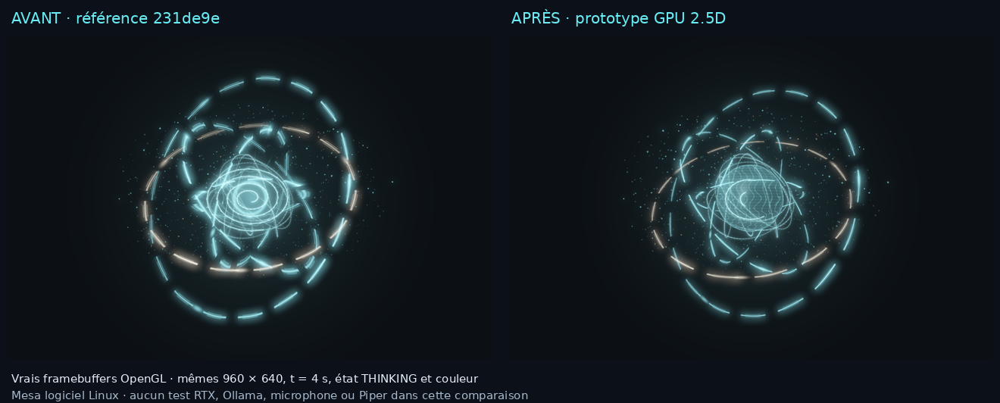

# UX Polish et PRESENCE 2.5D — phase préparatoire

27 octobre 2026. Base inspectée : `231de9e`, branche
`feat/jalon-2-voice-presence`, dépôt propre et synchronisé. `main` reste inchangée.
Les LOTS 4, 5 et 7 ne sont pas commencés dans cette mission.

## Chantier A : navigation et aperçus Canvas

| Famille conservée | Accès courant | Personnalisation ou outils avancés |
| --- | --- | --- |
| PRESENCE | Studio | Onde, halo, noyau, styles, sous-titres, morphing, Mini |
| Conversation et mémoire | Politique cognitive, génération, souvenirs | Inspection du contexte préparé |
| Voix | Périphériques et voix | Vitesse/silence ciblés, diagnostic et réglages avancés existants |
| Interface | Métriques et navigation | Lecture, police, taille, densité et accents |
| Système, sécurité et performances | Modèle installé | Adresse Ollama, informations locales et prototype GPU |

Les familles restent identiques. Essentiel → Personnaliser → Avancé révèle
progressivement les liens vers les mêmes éditeurs. La recherche locale traverse
tous les niveaux. Favoris stocke uniquement des identifiants validés et bornés,
avec le niveau de navigation, dans `Store.preferences["control_center"]`.
Les clés futures sont préservées ; les erreurs d'écriture restent visibles et ne
remplacent pas les choix précédents. Aucun réglage métier n'est dupliqué.

Le Studio permet de viser directement sept états du même Canvas. Un seul
contrôleur de démonstration gère le scénario complet et les aperçus de quatre
secondes. Signaux synthétiques indiqués à l'écran ; pas de capture ou d'inférence.
Les vrais événements, masquage, fermeture et interruption restent prioritaires.

Quatre styles distincts réemploient les paramètres actuels : Hologramme cyan,
Ambre · concentration, Spectre doux, Récit expressif. Ils conservent le plafond
de qualité, les préférences d'accessibilité et l'activation du morphing. Les
valeurs restent dans le brouillon jusqu'à Appliquer. Avant/Après, Annuler et
Restaurer gardent leur contrat transactionnel.

Un défaut existant a été reproduit pendant la non-régression : à 250 % DPI,
l'en-tête de provenance demandait 667 px dans une fenêtre de 660 px et masquait
la liste des sources. Le résumé est désormais borné et défilant ; Fermer reste
réservé en bas. L'inspection conserve les mêmes données et noms de widgets.
Une régression vérifie sélection, provenance, défilement et fermeture à
600×480 aux échelles 100/250 %, sans réduire les contrôles sur les originaux.


La recette utilisateur et les raccourcis sont dans [CONTROL-STUDIO.md](CONTROL-STUDIO.md).
Les preuves visuelles proviennent des véritables composants sous Linux/Tk ;
elles ne valident pas l'esthétique ou le matériel Windows du PC utilisateur.

Validation A : **188 tests intégrés Tk9 réussis**, puis **41 tests ciblés
Tk8.6 réussis**. Navigation, favoris, DPI, persistance, provenance, voix,
morphing et interruptions couverts ; campagnes qui se recouvrent.

## Chantier B : prototype GPU autonome

Le moteur OpenGL existant est conservé séparément de `Jarvis.exe`. La projection,
la matière du noyau et les couches lumineuses évoluent dans ses shaders :

- Anneaux circulaires dans des plans inclinés, projetés en perspective par
  intersection rayon/plan ; leurs portions arrière sont masquées par le noyau.
- Noyau sphérique analytique, éclairage directionnel, veines énergétiques et
  émission procédurale, sans texture téléchargée ni raymarching.
- Courbes, filaments et particules partagent la même caméra et la même visibilité
  par profondeur. Les filaments utilisent une profondeur moyenne par segment
  court : c'est une approximation 2.5D, pas une scène volumétrique complète.
- Aucun nouveau buffer, texture, pass ou paquet. Le renderer garde son API et
  les états/morphings existants. À reactor=0 : signal PCM, symboles et repos plat
  restent prioritaires. La réduction de mouvement fige les couches générées.

Canvas demeure le moteur de production. Aucun raccordement GPU/Tk/voix ni repli
automatique de production n'est annoncé par ce prototype séparé.



[Animation comparative](assets/presence-gpu-25d-comparison.mp4) : 125 captures
réelles, horloge fixe, cinq secondes encodées à 25 images/s, sans audio. Ce débit
d'export n'est pas une mesure de performance. Les images originales avant/après
proviennent du même viewport 960 × 640, THINKING, couleur et instant t = 4 s.

### Mesures disponibles

Processus frais pour chaque cas, shaders chauffés avant mesure, rendu EGL réel
avec `ctx.finish()`, cadencement 30/45 FPS identique, captures exclues du chronométrage.
Référence : renderer/shaders de `231de9e` ; pipeline d'états/morphing courant
identique pour les deux versions. Hashes des sources et preuves dans le
[rapport JSON](benchmarks/presence-gpu-25d-linux.json).

| Cas, fenêtres de 5 s | FPS avant → après | CPU avant → après | RSS moyen avant → après |
| --- | ---: | ---: | ---: |
| Équilibré | 29,79 → 27,96 | 333,21 → 354,08 % | 113,47 → 99,07 MiB |
| Cinématique | 32,34 → 34,14 | 396,14 → 397,31 % | 101,02 → 99,04 MiB |

CPU 100 % = un cœur. Ces résultats sont du **Mesa llvmpipe logiciel Linux**, sans
GPU physique. Les variations courtes d'environ 6 % ne démontrent ni gain
statistique, ni baisse mémoire, ni performance RTX. Repos et mouvement réduit :
une frame mesurée puis attente sur trois secondes, avant et après. Les octets
graphiques demandés restent 7 380 864 (environ 7,04 MiB), hors driver/programmes et
framebuffer de présentation ; ce n'est pas de la VRAM physique mesurée.
VRAM physique, temps GPU précis, watts et latences IA/voix restent non mesurés.

Le helper reproductible refuse d'écraser un dossier de sortie. Exemple dans un
environnement Python contenant les dépendances facultatives GPU ; utiliser
`--backend default` sur Windows, `--backend egl` pour cette recette Linux :

```powershell
py scripts/compare_presence_gpu.py --revision 231de9e --case balanced --backend default --seconds 5 --output comparaison-avant
py scripts/compare_presence_gpu.py --revision current --case balanced --backend default --seconds 5 --output comparaison-apres
```

Les cas `idle`, `cinematic` et `reduced` complètent le cas `balanced`. Les formats,
révisions, sorties existantes et snapshots sont testés ; les sondes et le build
GPU Windows restent ceux du [guide GPU](PRESENCE-GPU.md).

**Validation matérielle en attente** : Windows 11, DPI entre moniteurs,
microphone/Piper/Qwen et coexistence RTX3070/Ollama. Aucune mesure cloud ne
remplace cette recette. Aucun modèle, pack graphique ou moteur obligatoire ajouté.

## Validation intégrée

Suite complète Linux/Tk9 avec OpenGL/EGL réel requis : **624 tests exécutés,
615 réussis, 9 ignorés**, 80,042 s. Les ignorés concernent six dépendances natives
absentes et trois essais matériels/modèles réels opt-in. Les 16 tests du renderer
GPU ont tous réussi ; les cinq tests du helper couvrent les sorties et snapshots.
L'environnement de test démarre à100%DPI ; les cas de tailles/DPI spécifiques
restent vérifiés séparément, avec restauration des préférences de test.

Chantier A : 188 tests intégrés Tk9 et41 ciblés Tk8.6 réussis. Les campagnes se
recouvrent, leurs comptes ne s'additionnent pas. Les résultats CI Windows du
commit publié sont consultables dans Actions ; ils ne prouvent pas la capture
matérielle ou les performances RTX. Aucune intégration GPU de production, aucun
modèle ajouté/supprimé, aucun travail des LOTS4/5/7.
