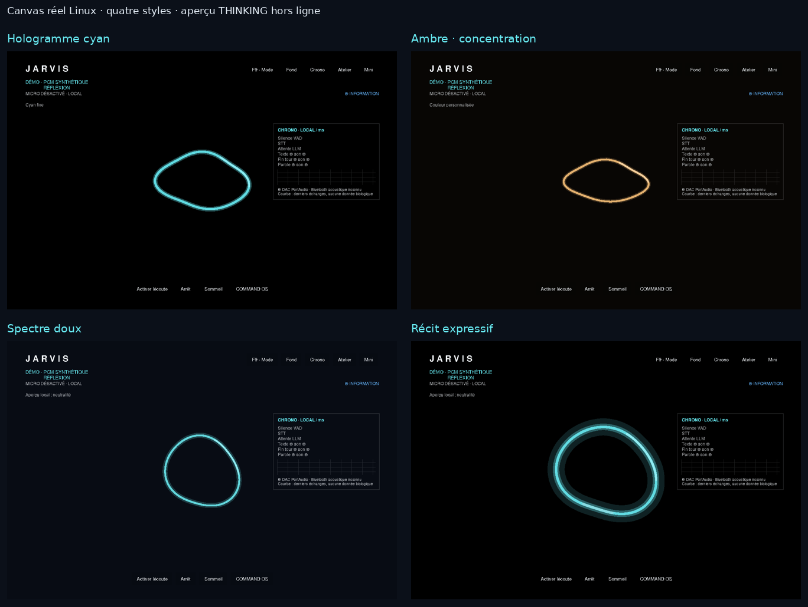

# UX Polish et PRESENCE 2.5D — phase préparatoire

27 octobre 2026. Base inspectée : `231de9e`, branche
`feat/jalon-2-voice-presence`, dépôt propre et synchronisé. `main` reste inchangée.
Les LOTS 4, 5 et 7 ne sont pas commencés dans cette mission.

## Chantier A : navigation et aperçus Canvas

| Famille conservée | Accès courant | Personnalisation ou outils avancés |
| --- | --- | --- |
| PRESENCE | Studio | Onde, halo, noyau, styles, sous-titres, morphing, Mini |
| Conversation et mémoire | Politique cognitive, génération, souvenirs | Inspection du contexte préparé |
| Voix | Périphériques et voix | Vitesse/silence ciblés, diagnostic et réglages avancés existants |
| Interface | Métriques et navigation | Lecture, police, taille, densité et accents |
| Système, sécurité et performances | Modèle installé | Adresse Ollama, informations locales et prototype GPU |

Les familles restent identiques. Essentiel → Personnaliser → Avancé révèle
progressivement les liens vers les mêmes éditeurs. La recherche locale traverse
tous les niveaux. Favoris stocke uniquement des identifiants validés et bornés,
avec le niveau de navigation, dans `Store.preferences["control_center"]`.
Les clés futures sont préservées ; les erreurs d'écriture restent visibles et ne
remplacent pas les choix précédents. Aucun réglage métier n'est dupliqué.

Le Studio permet de viser directement sept états du même Canvas. Un seul
contrôleur de démonstration gère le scénario complet et les aperçus de quatre
secondes. Signaux synthétiques indiqués à l'écran ; pas de capture ou d'inférence.
Les vrais événements, masquage, fermeture et interruption restent prioritaires.

Quatre styles distincts réemploient les paramètres actuels : Hologramme cyan,
Ambre · concentration, Spectre doux, Récit expressif. Ils conservent le plafond
de qualité, les préférences d'accessibilité et l'activation du morphing. Les
valeurs restent dans le brouillon jusqu'à Appliquer. Avant/Après, Annuler et
Restaurer gardent leur contrat transactionnel.

Un défaut existant a été reproduit pendant la non-régression : à 250 % DPI,
l'en-tête de provenance demandait 667 px dans une fenêtre de 660 px et masquait
la liste des sources. Le résumé est désormais borné et défilant ; Fermer reste
réservé en bas. L'inspection conserve les mêmes données et noms de widgets.
Une régression vérifie sélection, provenance, défilement et fermeture à
600×480 aux échelles 100/250 %, sans réduire les contrôles sur les originaux.

La recette utilisateur et les raccourcis sont dans [CONTROL-STUDIO.md](CONTROL-STUDIO.md).
Les preuves visuelles proviennent des véritables composants sous Linux/Tk ;
elles ne valident pas l'esthétique ou le matériel Windows du PC utilisateur.

Validation A : **188 tests intégrés Tk9 réussis**, puis **41 tests ciblés
Tk8.6 réussis**. Navigation, favoris, DPI, persistance, provenance, voix,
morphing et interruptions couverts ; campagnes qui se recouvrent.

## Chantier B : prototype GPU autonome

Le moteur OpenGL existant est conservé séparément de `Jarvis.exe`. La projection,
la matière du noyau et les couches lumineuses évoluent dans ses shaders ;
Canvas demeure le moteur de production. La comparaison et les mesures sont
documentées après validation du prototype, sans annoncer d'intégration RTX.

**Validation matérielle en attente** : Windows 11, DPI entre moniteurs,
microphone/Piper/Qwen et coexistence RTX3070/Ollama. Aucune mesure cloud ne
remplace cette recette. Aucun modèle, pack graphique ou moteur obligatoire ajouté.
